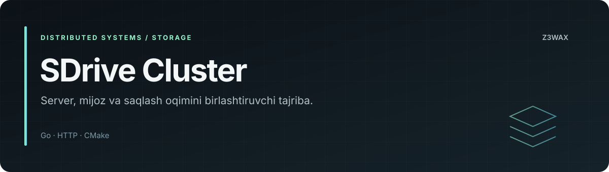

<!-- z3wax:presentation:start -->


[Loyiha xaritasi va misol](docs/PROJECT_GUIDE.md) · [Roadmap](ROADMAP.md) · [Baholash](docs/EVALUATION.md) · [Changelog](CHANGELOG.md) · [Relizlar](docs/RELEASING.md)

**Tekshiruvlar:** [Documentation workflow](https://github.com/z3wax/cluster/actions/workflows/documentation.yml)

Hujjatlar CI holati dastur yoki model testlari holatidan alohida.
<!-- z3wax:presentation:end -->

# SDrive Cluster

Go HTTP backend, brauzer interfeysi va CMake asosidagi mijozni birlashtiruvchi klaster loyihasi.

**Loyiha egasi:** [z3wax](https://github.com/z3wax)

## Repozitoriy xaritasi

| Yo'l | Vazifasi |
|---|---|
| [backend/](backend/) | Go server va API |
| [backend/web/](backend/web/) | Server uzatadigan statik interfeys |
| [client/](client/) | CMake asosidagi mijoz |
| [SHARTNOMA.md](SHARTNOMA.md) | Loyiha shartnomasi |

## Bir modelni bir nechta CPU'da ishlatish

[inference/README.md](inference/README.md) — bitta GGUF modelini bir nechta kompyuter CPU'lari orasida taqsimlash, worker'larni ishga tushirish va OpenAI formatidagi API.

## Backendni ishga tushirish

[backend/go.mod](backend/go.mod) da Go `1.26` ko'rsatilgan. Shu modul talabiga mos toolchain ishlating.

```bash
git clone https://github.com/z3wax/cluster.git
cd cluster/backend
go run . -addr 127.0.0.1:8080 -data ./data
```

Brauzer: http://127.0.0.1:8080

| Flag | Standart | Vazifasi |
|---|---|---|
| `-addr` | `:8080` | Tinglash manzili |
| `-data` | `data` | Saqlash katalogi |

Server `db.json` va `chunks/` katalogini ma'lumotlar papkasida yuritadi. Statik fayllar ishchi katalogga nisbatan qidiriladi; yuqoridagi buyruqni `backend/` ichidan bajaring.

## Mijoz

[client/CMakeLists.txt](client/CMakeLists.txt) — yig'ish konfiguratsiyasi; [client/build.bat](client/build.bat) — Windows yordamchi skripti. Mijoz uchun kerakli kompilyator va bog'liqliklarni shu fayllardan tekshiring. Backendni ishga tushirish mijozni avtomatik yig'maydi.

## Tekshirish

```bash
cd backend
go test ./...
go vet ./...
```

Bu buyruqlar tavsiya etilgan lokal tekshiruvlar; ularning natijasi bu hujjatda oldindan muvaffaqiyatli deb belgilanmaydi. Serverni ishga tushirib interfeys yuklanishi va qayta ishga tushirganda ma'lumotlar saqlanishini ham tekshiring.

## Ishlatish eslatmalari

Lokal tekshiruv uchun `127.0.0.1` dan foydalaning. Serverdagi CORS siyosati keng; internetga chiqarishdan oldin mavjud API autentifikatsiyasi va tarmoq kirishini baholang. `data/` ni zaxiralang. PID, log, tayyor EXE va ZIP fayllari manba kodini yig'ish ko'rsatmasi o'rnini bosmaydi.

## Hissa qo'shish

[CONTRIBUTING.md](CONTRIBUTING.md). Server va mijozga tegishli o'zgarishlarni alohida tushuntiring.
