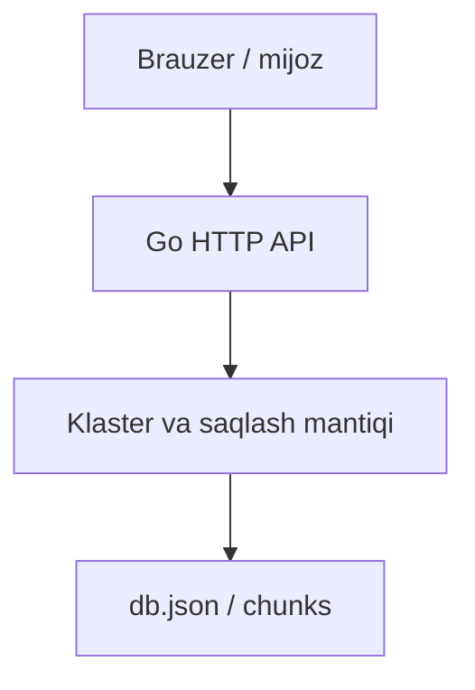

# SDrive Cluster — loyiha xaritasi

[README](../README.md) · [Roadmap](../ROADMAP.md) · [Baholash](EVALUATION.md) · [Reliz tartibi](RELEASING.md)

## Maqsad

Server, mijoz va saqlash oqimini birlashtiruvchi tajriba.

**Texnologiyalar:** Go · HTTP · CMake.

## Arxitektura va oqim

Asosiy oqimning ixcham xaritasi; batafsil xulq manba kodida berilgan.



## Boshlang‘ich misol

Quyidagi buyruqlarni README dagi talablar va sozlash bosqichlaridan keyin, repozitoriy ildizidan bajaring:

```bash
cd backend
go run . -addr 127.0.0.1:8080 -data ./data
```

backend/go.mod talabiga mos Go toolchain kerak. Lokal interfeys: http://127.0.0.1:8080.

Bu qo‘llanma misolni ushbu hujjat yangilanishi vaqtida bajarilgan test sifatida ko‘rsatmaydi. Test dalili, qurilma va natija baholash hisobotida alohida saqlanadi.

## Manba xaritasi

[backend/main.go](../backend/main.go) · [backend/api.go](../backend/api.go) · [backend/store.go](../backend/store.go) · [client/CMakeLists.txt](../client/CMakeLists.txt)

## Ish jarayoni

1. Lokal yoki test muhitini tayyorlang.
2. Yuqoridagi eng kichik oqimni tekshiring.
3. Ta’sirlangan modulning testini bajaring.
4. Faqat haqiqiy natijalarni hisobotga kiriting.

[Hissa qo‘shish](../CONTRIBUTING.md) · [O‘zgarishlar](../CHANGELOG.md)
